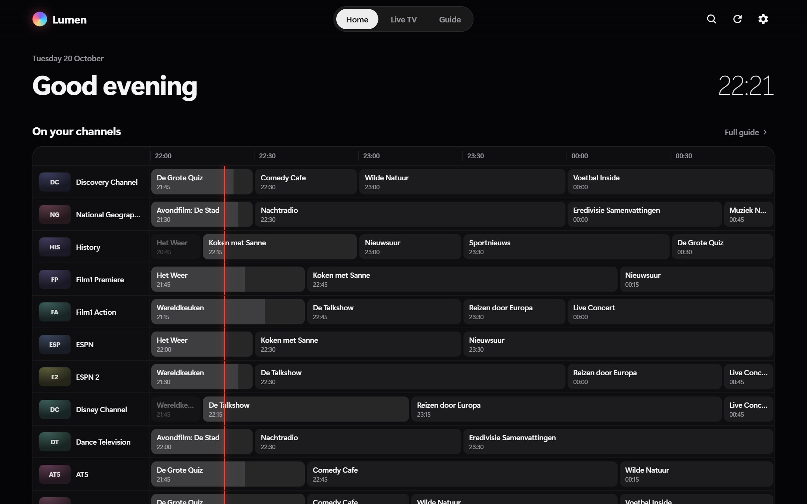
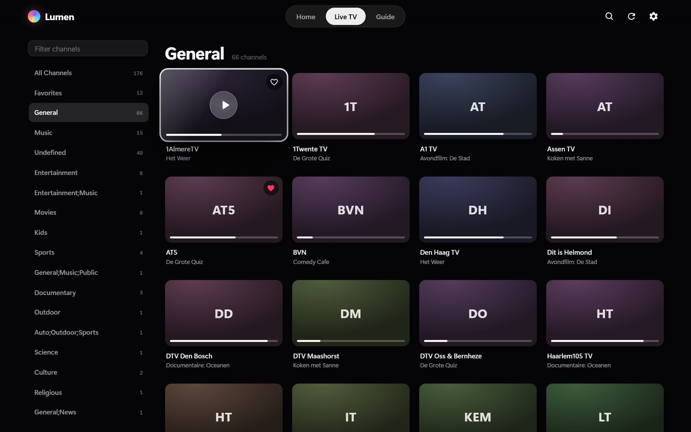
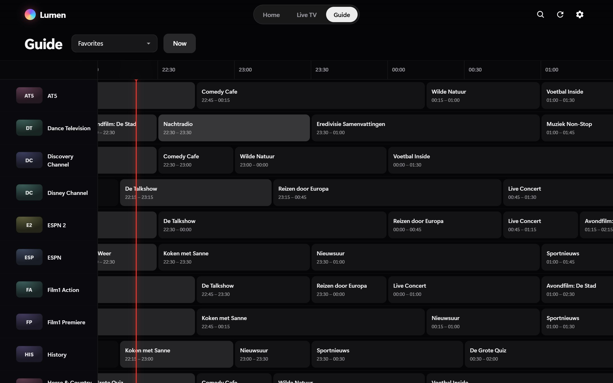
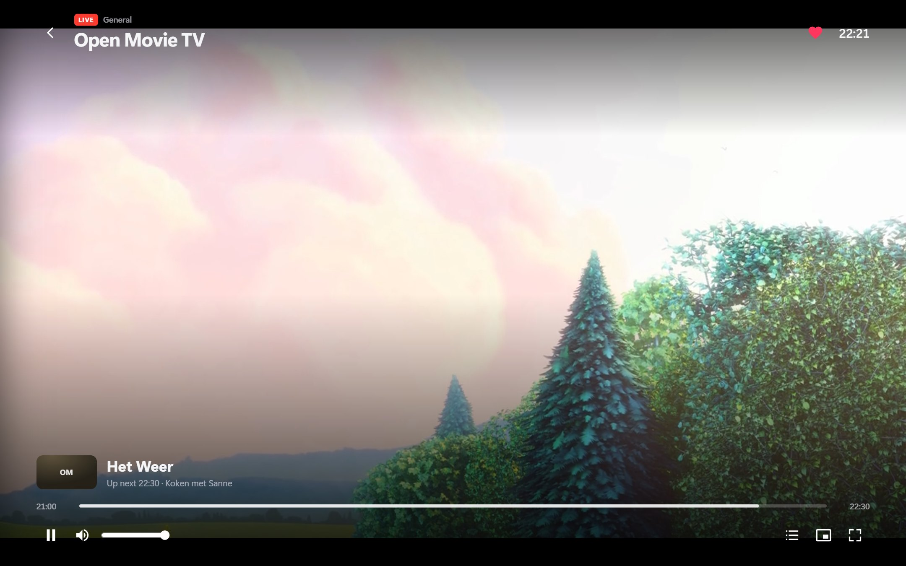
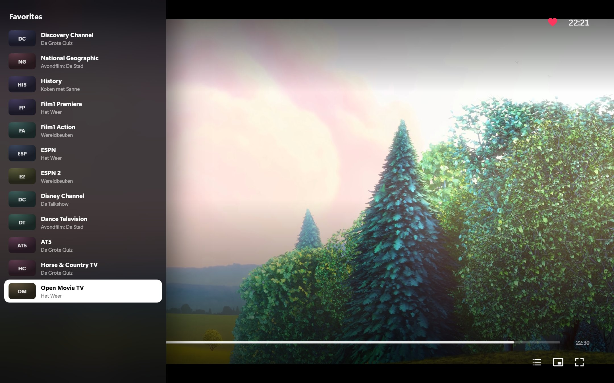
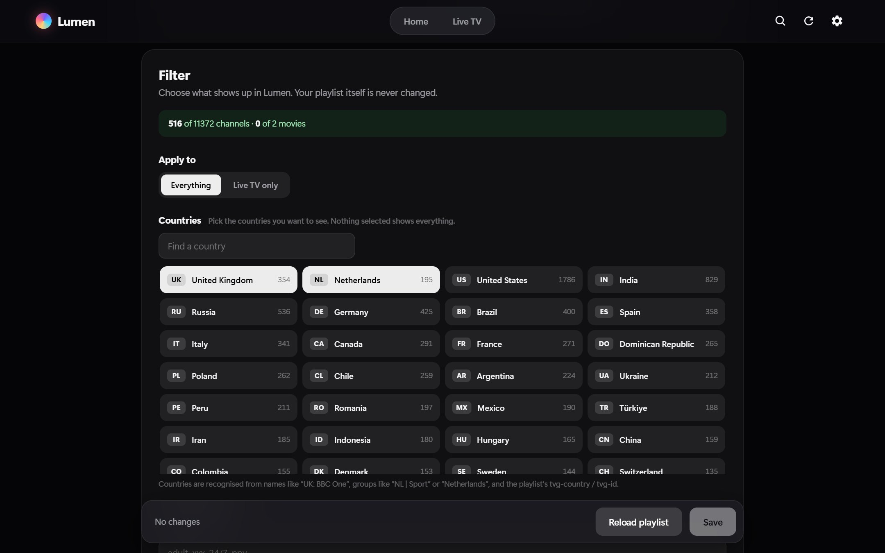
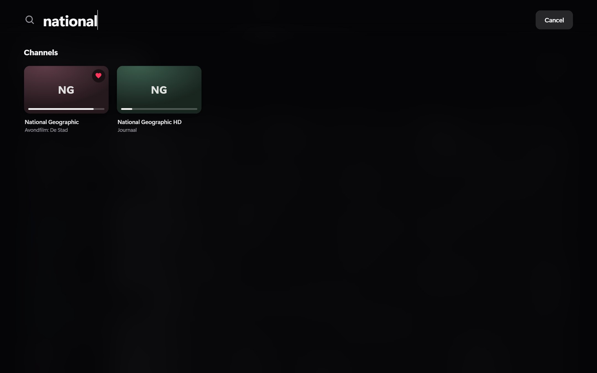
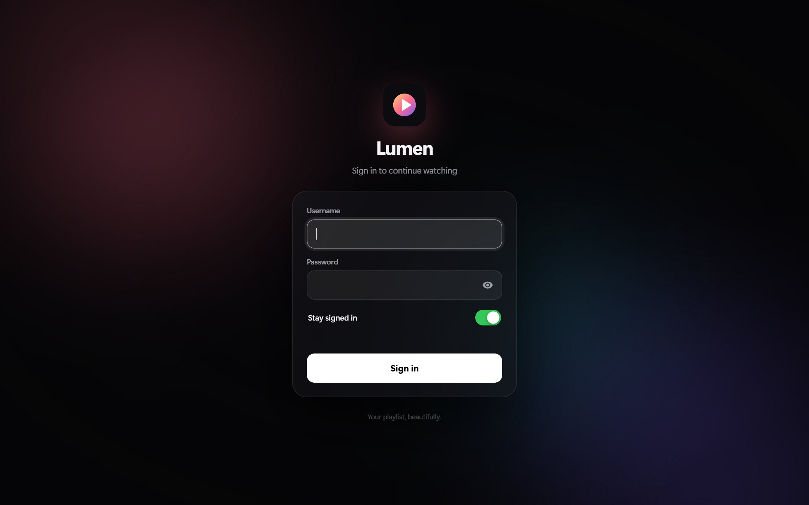
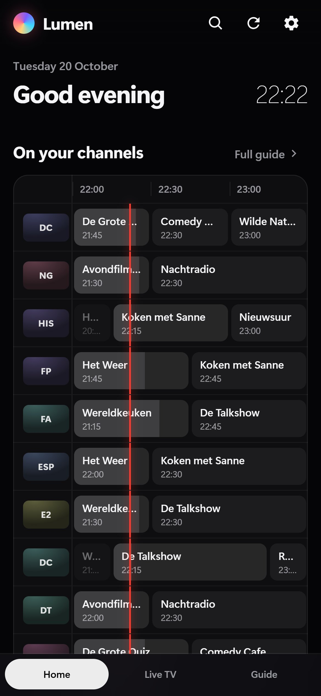
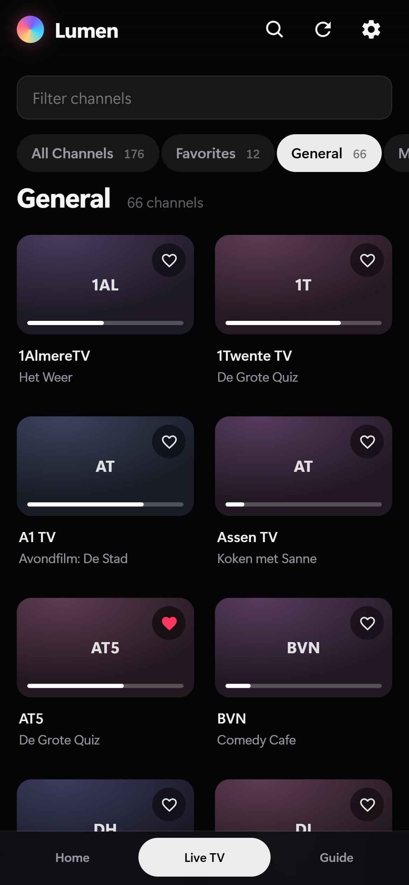

<div align="center">


# Lumen

**Your IPTV playlist, with the polish of Apple TV.**

A fast, beautiful web player for M3U playlists and Xtream Codes accounts — live TV, a real TV guide, movies and series, right in your browser.

[](https://github.com/RichrdJ/lumen/actions/workflows/docker.yml)
[](https://github.com/RichrdJ/lumen/releases)
[](https://github.com/RichrdJ/lumen/pkgs/container/lumen)
[](#quick-start)
[](LICENSE)



</div>

## Why Lumen

|  |  |
| --- | --- |
| 🎬 **Feels like a real TV app** | Frosted glass, tiles that lift on focus, smooth zapping with an on-screen display. Works with a mouse, a keyboard, a TV remote or your thumb. |
| ⚡ **Fast with huge playlists** | Parsed and cached on the server, virtualized grids and guide. 20,000 channels scroll like 20. |
| ❤️ **Your channels first** | Home shows only your favorites, in the order *you* drag them into, with a 3-hour mini guide of what's on. Shared across all your devices. |
| 🌍 **Only the countries you watch** | Pick UK and NL and the other 10,000 channels disappear. Country codes like `\| NL \|` are stripped from names, too. |
| 📺 **Plays (almost) everything** | HLS, raw MPEG-TS, MP4/MKV — with an automatic ffmpeg fallback for audio your browser can't decode. |
| 🔌 **No CORS headaches** | Streams, playlists and logos go through Lumen, so mixed-content and CORS errors are gone. Logos are cached on disk. |
| ⚙️ **Set up in the app** | Sources, guide, filter, playback and an optional login all live in a settings page. Docker only needs a port and a volume. |

## Screenshots

<table>
  <tr>
    <td width="50%"><br><b>Live TV</b> — groups, now playing and progress on every tile</td>
    <td width="50%"><br><b>Guide</b> — a full timeline with a live “now” line</td>
  </tr>
  <tr>
    <td><br><b>Player</b> — programme info, progress and up next</td>
    <td><br><b>Zap list</b> — switch channels without leaving the player</td>
  </tr>
  <tr>
    <td><br><b>Filter</b> — pick countries, hide groups, live preview</td>
    <td><br><b>Search</b> — instant, across channels, movies and series</td>
  </tr>
  <tr>
    <td><br><b>Sign in</b> — optional login with a proper sign-in page</td>
    <td></td>
  </tr>
</table>

<p align="center">
  
  &nbsp;&nbsp;
  
</p>

<sub>Screenshots use the public <a href="https://github.com/iptv-org/iptv">iptv-org</a> Dutch channel list with a generated sample guide; the player shows Big Buck Bunny (CC-BY, Blender Foundation).</sub>

## Quick start

### Docker Compose

```yaml
services:
  lumen:
    image: ghcr.io/richrdj/lumen:latest
    restart: unless-stopped
    ports:
      - "4242:4242"
    volumes:
      - ./data:/data
    environment:
      TZ: "Europe/Amsterdam"
```

```bash
docker compose up -d
```

### Docker Swarm / Portainer

```bash
docker stack deploy -c docker-stack.yml lumen
```

In Portainer: **Stacks → Add stack**, paste [`docker-stack.yml`](docker-stack.yml) and deploy.

Then open **`http://<host>:4242`**, click the ⚙️ and add your playlist. That's it.

## Settings

Everything is configured in the app and stored in `/data/settings.json`.

- **Sources** — M3U URLs, an Xtream Codes account, XMLTV guide URLs, refresh interval and user agent. Files dropped into `/data` (`*.m3u`, `*.xml`, `*.xml.gz`) are picked up automatically.
- **Filter** — pick countries (e.g. just UK and NL) and only those are shown; hide groups or keywords; apply it to everything or live TV only. A live preview shows what's left. Countries are recognised from `tvg-country`, `tvg-id` (`BBCOne.uk`), and names or groups like `UK:`, `NL |`, `[DE]`, `FR -` or `Netherlands`.
- **Display** — hide country codes in channel names (`| NL | ESPN 1` → `ESPN 1`), on by default.
- **Playback** — stream proxy, artwork cache, ffmpeg video re-encoding.
- **Login** — optional username and password (stored hashed). Visitors get a sign-in page with "stay signed in" (30 days); sessions are signed cookies, repeated wrong attempts are throttled, and changing the password signs out every other device. HTTP Basic auth is still accepted for scripts.

<details>
<summary><b>Environment variables</b> (optional, for automated deployments)</summary>

Environment variables act as defaults for anything not yet saved in Settings.

| Variable | Description |
| --- | --- |
| `M3U_URL`, `M3U_FILE` | Playlist URLs / files (comma separated). |
| `XTREAM_URL`, `XTREAM_USER`, `XTREAM_PASS`, `XTREAM_LIVE_FORMAT` | Xtream Codes account. |
| `EPG_URL`, `EPG_FILE` | XMLTV guides. |
| `FILTER_COUNTRIES` | e.g. `UK,NL`. |
| `FILTER_EXCLUDE` | Keywords to hide, comma separated. |
| `CLEAN_NAMES` | `false` keeps country codes in channel names. |
| `REFRESH_HOURS`, `PROXY`, `PROXY_IMAGES`, `USER_AGENT`, `TRANSCODE_VIDEO` | Same as in Settings. |
| `AUTH_USER`, `AUTH_PASS` | Login. |
| `PORT`, `DATA_DIR`, `TZ` | Container basics (port defaults to `4242`). |

</details>

## Favorites

- **Add** — tap the ♥ on any tile, in the player or on a detail page (or press `f` on a focused tile).
- **Arrange** — drag tiles on Home with the mouse. On a phone, tablet or TV remote, tap **Edit order** first; with a remote, Enter picks a tile up, the arrows move it, Enter drops it.
- **Zap** — start a channel from Home and ↑/↓ walks through your favorites in that same order.

Favorites are stored on the server (`/data/favorites.json`), so every device sees the same list.

## Keyboard & remote

| Key | Browse | Player |
| --- | --- | --- |
| Arrows | Move focus | ↑/↓ zap, ←/→ seek 10 s (when controls are hidden) |
| Enter | Open / play | Show controls |
| Esc / Backspace | Close dialog | Close player |
| `/` or Ctrl+K | Search | |
| `f` | Toggle favorite | Fullscreen |
| Space / `k` | | Play / pause |
| `m` / `c` / `p` | | Mute / channel list / picture-in-picture |
| PageUp / PageDown | | Previous / next channel |

## Development

```bash
npm install
npm run dev   # then open http://localhost:4242/#/settings
```

No build step: the frontend is plain ES modules in `public/`, the server is dependency-light Node in `server/`.

Built on [hls.js](https://github.com/video-dev/hls.js), [mpegts.js](https://github.com/xqq/mpegts.js) and [sax](https://github.com/isaacs/sax-js).

## License

[MIT](LICENSE)
